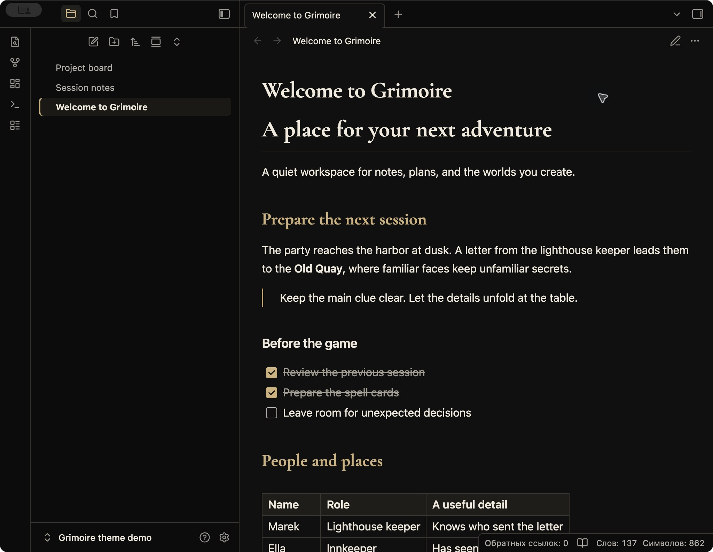
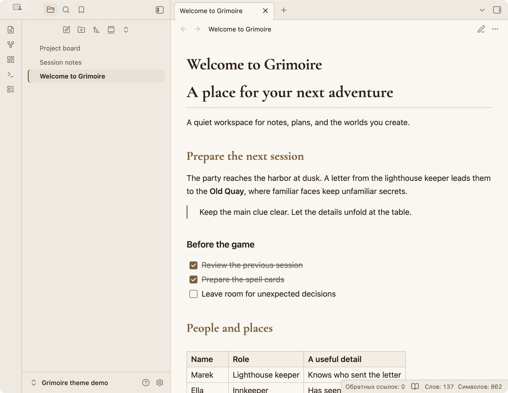

# Grimoire

A calm theme for Obsidian with warm neutrals, muted gold accents, and book-inspired headings. Built for everyday notes, project boards, and the worlds you create.

Grimoire includes dark and light color schemes, sharing the visual language of [Grimoire](https://grimoireapp.app), the tabletop character app.

## Design

- Dark mode: near-black surfaces, warm white text, and soft gold accents.
- Light mode: cream surfaces, dark brown text, and bronze accents.
- Grimoire Display in first- and second-level headings; system fonts for body text and controls.
- Thin dividers, readable tables, clear links, and modest corners.
- Embedded font for offline use. No remote assets, tracking, background images, or animations.
- Optional color adjustments for the community Kanban plugin.

The theme works without community plugins. A theme changes appearance; any task movement or other automation comes from your chosen plugins.

## Requirements and testing

Requires Obsidian **1.14.0 or newer**. Tested with Obsidian **1.14.5 on macOS**, in dark and light modes. Other operating systems and the mobile app have not yet been verified.

Kanban color adjustments were checked with **Kanban 2.0.51**. Kanban is an optional third-party plugin and is not included with the theme.

## Install

Until Grimoire is available in the community directory, use manual installation:

1. Download `manifest.json` and `theme.css` from the same release.
2. Create a folder named `Grimoire` in your vault's `.obsidian/themes/` directory.
3. Put both downloaded files in that folder.
4. Open **Settings → Appearance → Themes** and select **Grimoire**.
5. Under **Base color scheme**, choose **Dark**, **Light**, or **Adapt to system**.

After the theme is listed in the community directory, it can also be installed from **Settings → Appearance → Themes → Manage**.

## Feedback

Please open a repository issue with your Obsidian version, operating system, active color scheme, and a small example that shows the issue. If a plugin is involved, include its name and version. Remove private note contents from screenshots.

## License and font attribution

The theme styling and documentation are available under the [MIT License](LICENSE).

The embedded **Grimoire Display** typeface is derived from **Cormorant Garamond**, copyright 2015 the Cormorant Project Authors. The font remains under the **SIL Open Font License 1.1**, separately from the theme styling. The complete font license is included in [LICENSES/CormorantGaramond-OFL.txt](LICENSES/CormorantGaramond-OFL.txt) and in the header of `theme.css`, so it accompanies the font when the theme is installed.

Screenshots use fictional demonstration notes.

---

## По-русски

Grimoire — спокойная тема для заметок и рабочих досок: тёплые нейтральные цвета, приглушённые золотистые акценты и книжные заголовки. Есть светлый и тёмный варианты. Оформление связано с визуальным стилем [приложения Grimoire](https://grimoireapp.app).

Основной текст и элементы управления используют системный шрифт. Фирменный шрифт заголовков встроен в тему и работает без интернета. Фоновых изображений, текстур и анимации нет.

Для установки вручную положите `manifest.json` и `theme.css` из одного релиза в папку `.obsidian/themes/Grimoire` вашего хранилища. Затем выберите Grimoire в **Настройки → Оформление → Темы**. Светлый и тёмный варианты переключаются в пункте **Основная тема**.

Проверено в Obsidian 1.14.5 на macOS. Тема может работать самостоятельно; для доски Kanban нужен отдельный плагин. Лицензия оформления — MIT, встроенного шрифта — SIL OFL 1.1.
